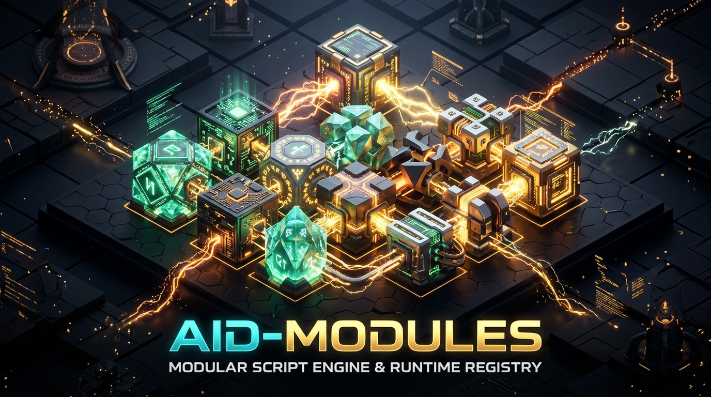

# AID-Modules 📦



[]()
[](LICENSE)
[]()
[](SPECIFICATION.md)

> Standard module registry, dependency checker, and discovery contract for **AI Dungeon** scripts and interactive fiction.

**AID-Modules** establishes an open standard for modular AI Dungeon scripting. It solves the friction of multi-creator adventures by providing transparent module registration, SemVer dependency checking, runtime discovery, and universal in-game `/mods` diagnostics.

---

## 🌟 Why AID-Modules?

AI Dungeon's **Script Management Run Order** allows creators and players to stack multiple independent scripts sequentially (`Script 1 ➔ Script 2 ➔ Script 3`). However, until now:

1. **No Standard Module Discovery:** Scripts could not determine what other libraries were loaded in the scene.
2. **Brittle Dependency Failures:** If Script B depended on Script A, missing scripts produced cryptic `ReferenceError` crashes rather than clean, user-friendly guidance.
3. **No Lineage Traceability:** When players encountered bugs in multi-mod adventures, authors had no way to verify which script versions were active.
4. **Namespace Collisions:** Different creators invented conflicting globals (`state.modules`, `globalThis.MODS`, `window.plugins`).

**AID-Modules** provides a single, zero-dependency, open standard to unite the ecosystem.

---

## 🏗️ Architecture

AID-Modules operates on a **dual-layer discovery pattern**:

```
┌──────────────────────────────────────────────────────────────────┐
│  globalThis.AID_MODULES (Plain Object Dictionary)                │
│  - 100% backward-compatible direct storage                       │
│  - Any script can write without importing an external library    │
└─────────────────────────────────┬────────────────────────────────┘
                                  ▲
                                  │ (Syncs & Adopts)
                                  ▼
┌──────────────────────────────────────────────────────────────────┐
│  globalThis.AID (Registry Manager & API)                         │
│  - AID.register(spec)   - Validates spec & handles SemVer upgrades│
│  - AID.get(name)        - Retrieves module records & exports     │
│  - AID.has(name, range) - SemVer range checks (>=, ^, ~)         │
│  - AID.require(name)    - Safe dependency assertion with errors  │
│  - AID.report()         - Formatted manifest for /mods command   │
│  - AID.slashCommand()   - Binds /mods to aid-getopt routers      │
└──────────────────────────────────────────────────────────────────┘
```

---

## 🚀 Installation & Usage in AI Dungeon

### Method 1: As a Standalone Script in Your Run Order (Recommended)
1. Open your scenario on [AI Dungeon](https://play.aidungeon.com/).
2. In **Details ➔ Player presentation**, toggle **Mark as Script** to ON.
3. In **Scripts ➔ Library**, copy and paste the contents of **[`library-aid-modules.js`](library-aid-modules.js)**.
4. Place **AID-Modules** at the **TOP** of your scenario's **RUN ORDER**. Now all downstream scripts automatically share the registry!

### Method 2: Self-Bootstrapping (Bundled in Your Script)
If you are publishing a standalone script (like a dice roller or card engine) and want to be compliant without requiring users to install an extra script:
```javascript
// Register your module onto globalThis.AID_MODULES:
(globalThis.AID_MODULES ??= {})["my-dice"] = {
    name: "my-dice",
    version: "1.0.0",
    gitHash: "a1b2c3d",
    buildTime: "2026-11-06 20:00 UTC",
    author: "YourName",
    description: "Polyhedral dice roller for fantasy combat",
    exports: { roll: (d) => Math.floor(Math.random() * d) + 1 },
    diag: () => "my-dice v1.0.0 (a1b2c3d)"
};

// If the full AID manager is active, tell it to adopt:
if (typeof globalThis.AID?.register === "function") {
    globalThis.AID.register(globalThis.AID_MODULES["my-dice"]);
}
```

---

## 📖 API Reference

### `AID.register(moduleSpec)`
Registers a module following the [AMS v1.0.0 Specification](SPECIFICATION.md). If a newer version is already registered, older registrations are safely ignored.
```javascript
AID.register({
    name: "aid-getopt",
    version: "1.0.0",
    gitHash: "c9a8981",
    author: "Randy Viosca",
    description: "POSIX/GNU CLI flag parser & slash command router",
    exports: AIDGetopt,
    diag: () => `AID-Getopt v1.0.0 (c9a8981)`
});
```

### `AID.has(name, [semverRange])`
Checks if a module is registered, with optional SemVer matching (`>=1.0.0`, `^1.0.0`, `~1.0.0`).
```javascript
if (AID.has("aid-getopt", ">=1.0.0")) {
    console.log("AID-Getopt is available!");
}
```

### `AID.require(name, [semverRange])`
Returns the module's public `exports`. Throws a descriptive, user-friendly error if missing or if the version does not satisfy the range.
```javascript
const getopt = AID.require("aid-getopt", "^1.0.0");
```

### `AID.get(name)`
Retrieves the full module metadata record (or `null` if not found).

### `AID.list()`
Returns an array of all registered module records.

### `AID.report([options])`
Generates a formatted summary report for in-game display or diagnostics.
```javascript
console.log(AID.report({ verbose: true }));
```

```text
==================================================================
  📦 Active AI Dungeon Modules (3 loaded)
==================================================================
• aid-modules v1.0.0 (6e6966c) [2026-11-06 20:17 UTC]
  Standard module registry and introspection contract for AI Dungeon
• aid-getopt v1.0.0 (f951404) [2026-11-06 20:17 UTC]
  POSIX/GNU CLI flag parser & slash command router
• entity-cards v2.8.0 (dc6f6ae) [2026-11-06 05:05 UTC]
  Named Entity Recognition Story Cards for characters & lore
==================================================================
```

### `AID.slashCommand(app)`
Automatically binds a `/mods` (aliases `/plugins`, `/modules`) slash command to an [`aid-getopt`](https://github.com/viosca/aid-getopt) command router!

---

## 📜 Full Specification

Read the complete [AI Dungeon Module Specification (AMS v1.0.0)](SPECIFICATION.md) for full schema definitions, SemVer rules, and lifecycle details.

---

## 🧪 Testing

AID-Modules includes automated test coverage verifying registration, SemVer ranges, upgrade precedence, dictionary backward compatibility, and `/mods` command integration:

```bash
npm test
```

```
==================================================================
  TEST SUITE: AID-Modules (Standard Module Registry)
==================================================================
   ✔ Module registration, retrieval, and exports verified
   ✔ SemVer range matching (>=, ^, ~, <) verified
   ✔ Upgrade precedence (newer version wins, older ignored) verified
   ✔ 100% backward compatibility with globalThis.AID_MODULES dictionary verified
   ✔ AID.require() returns exports and provides clear error messages for missing dependencies
   ✔ AID.report() formats clean multiline manifest
   ✔ Event bus ('register' / 'unregister') verified
   ✔ In-game /mods slash command integrated with aid-getopt
==================================================================
  🎉 ALL AID-Modules TESTS PASSED (100% SUCCESS)
==================================================================
```

---

## 📄 License

MIT © Randy Viosca ([@Random_Variable](https://github.com/viosca))
